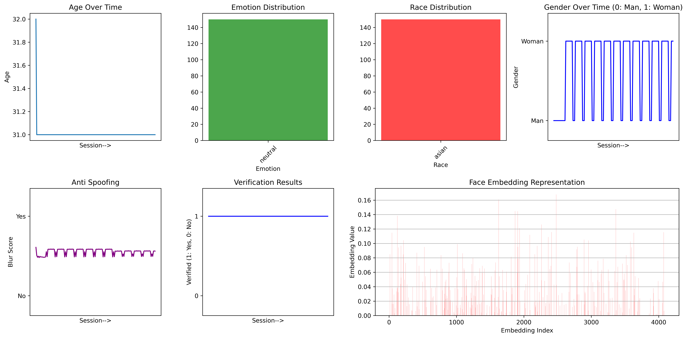

# Real-Time Facial Analysis with DeepFace

A Python computer-vision pipeline that analyses a video frame by frame. For each face it detects, it estimates **age, gender, emotion and ethnicity**, runs an **anti-spoofing (liveness) check**, and **verifies the person against a reference photo**. It then turns the results into a dashboard of charts.



## Highlights
- **Multi-task face analysis**: age, gender, emotion and race from DeepFace's pre-trained CNNs
- **Liveness detection**: an anti-spoofing score for each frame, to catch photo or screen attacks
- **Identity verification**: each frame is compared with a reference image using face embeddings
- **MTCNN face detection**: a reliable detector that copes with different poses and lighting
- **Visual analytics**: Matplotlib dashboards show age, gender and verification over time, plus emotion and race distributions and embedding vectors
- **GPU-ready**: TensorFlow with CUDA 12.x acceleration, plus a script that checks your GPU setup

## Tech Stack
Python 3.12 · TensorFlow 2.16 · DeepFace · OpenCV · MTCNN · NumPy · Pandas · Matplotlib

## How It Works
```text
Video (OpenCV) -> resize frame -> MTCNN face detection
   -> DeepFace.extract_faces(anti_spoofing)   liveness score
   -> DeepFace.analyze(age, gender, emotion, race)
   -> DeepFace.verify(frame, reference image)  same person?
   -> collect results -> Matplotlib dashboard (PNG)
```

## Sample Output
```text
Frame 1: {'anti_spoofing': 0.61, 'age': 32, 'gender': 'Man', 'emotion': 'neutral', 'race': 'asian', 'verification': True}
```

## Getting Started
```bash
git clone https://github.com/<your-username>/facial-analysis.git
cd facial-analysis
python -m venv venv
venv\Scripts\activate        # Windows  (source venv/bin/activate on macOS/Linux)
pip install -r requirements.txt

python verify_gpu.py         # optional: check GPU support
```
Put your own `test_image.jpg` (reference face) and `test_video.mp4` in the project folder, then run:
```bash
python run_demo.py           # quick demo on the first 5 frames
python projectnormal.py      # full video analysis
```
Press **q** to stop. The charts are saved as `analysis_plot_<timestamp>.png`.

## Project Structure
| File | Purpose |
|---|---|
| `projectnormal.py` | Main pipeline: processes the whole video and draws the charts |
| `run_demo.py` | Short demo run on 5 frames |
| `create_test_video.py` | Builds a test video from an image |
| `verify_gpu.py` | Checks that TensorFlow can use the GPU |
| `requirements.txt` | Pinned dependencies |

## What I Learned
- Building multi-model inference pipelines on top of pre-trained deep-learning models
- How face detection, embedding-based verification and liveness detection fit together
- Setting up TensorFlow with CUDA, and the trade-offs between running on CPU and GPU

## Future Improvements
- Live webcam input and on-screen overlays on each frame
- Batch processing so long videos run faster
- A web interface (FastAPI or Streamlit)

## Ethical Note
Facial attribute prediction, especially of race and gender, can be biased. This project is for learning purposes only. It should not be used for decisions about real people without their consent.

## Author
**Paras Gulve** · [GitHub](https://github.com/parasgulve) · [LinkedIn](https://www.linkedin.com/in/paras-gulve-92a991293/)
